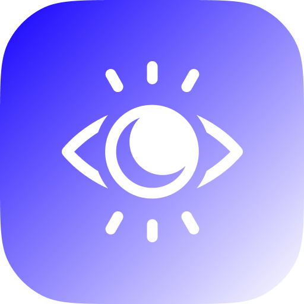
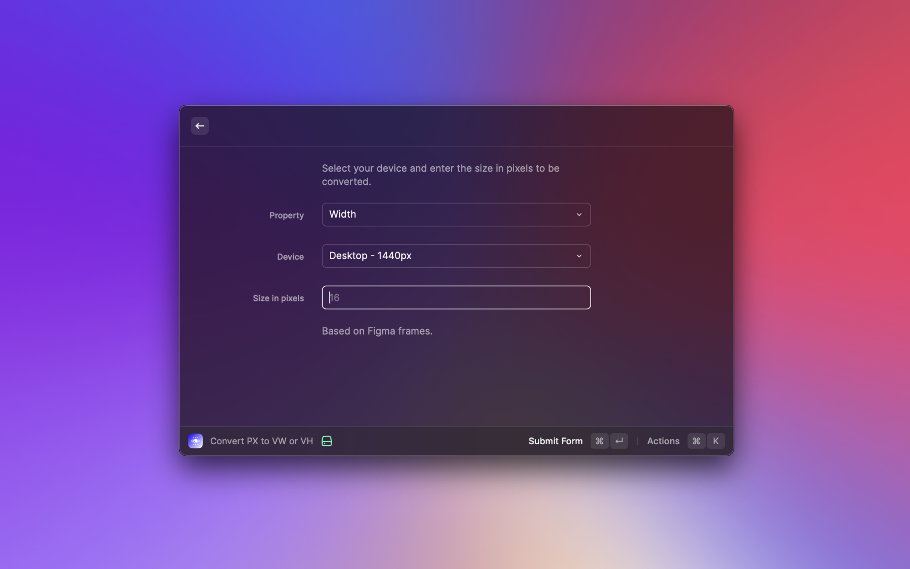
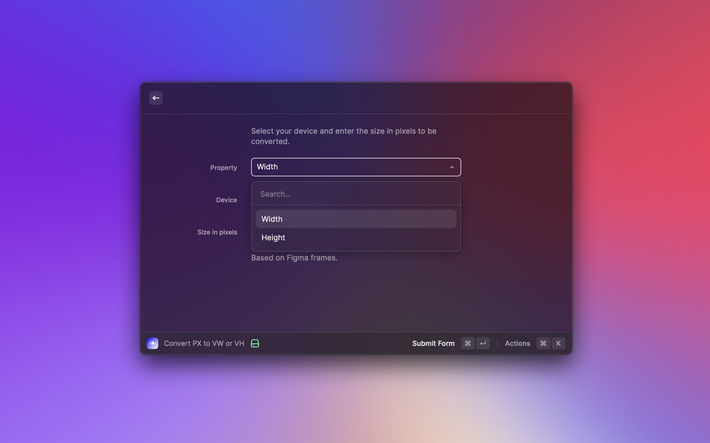
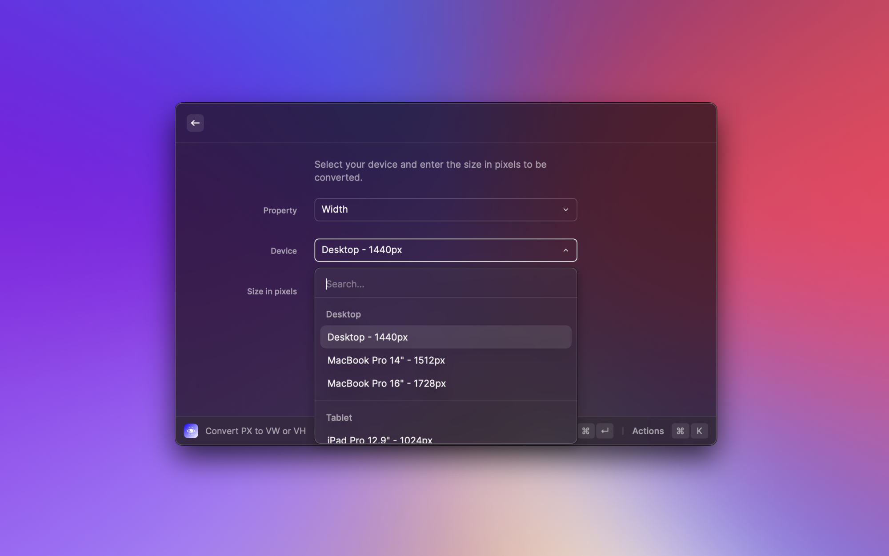
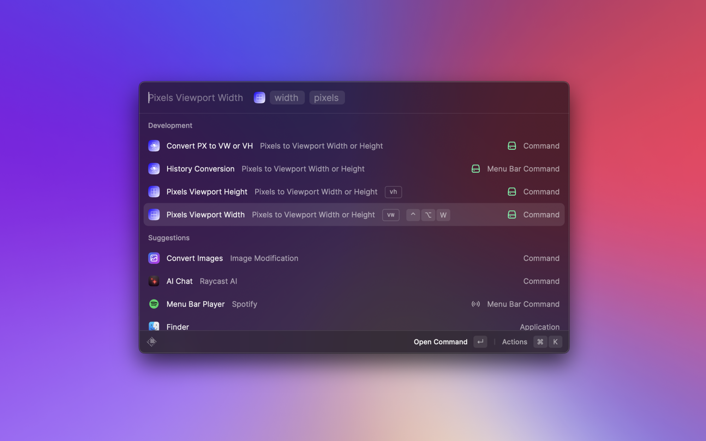
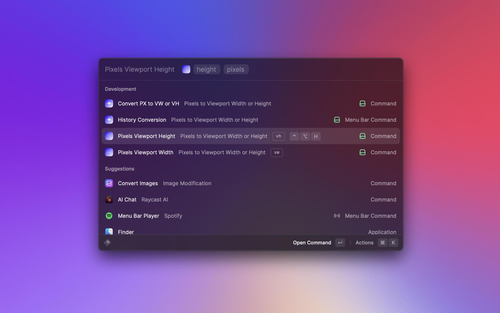

# Raycast Extension: Pixels to Viewport Width or Height



A Raycast extension that converts pixel values to viewport units (vw/vh) based on the chosen viewport size.

## Features

- Precise conversion of pixels to vw (viewport width) or vh (viewport height) based on the selected viewport size.
- Converted values are directly copied to the clipboard for quick and convenient use.

## Screenshots







_Screenshots of the extension in action_

## Installation

1. Make sure you have [Raycast](https://www.raycast.com) installed on your system.
2. Open Raycast and navigate to the "Extensions" tab.
3. Click on the "Add Extension" button.
4. Search for "Pixels to Viewport Width or Height" and install the extension.

## Usage

1. Launch Raycast.
2. Search and select "Convert PX to VW or VH".
3. Choose between viewport width or height.
4. Then choose your desired currency.
5. Enter the pixel value you want to convert.
6. The converted value in vw/vh will be automatically copied to the clipboard.

## Contribution

Contributions are welcome! If you want to improve this extension or add new features, feel free to open a pull request.

## License

This project is licensed under the MIT License. Please see the [LICENSE](LICENSE) file for more details.

---

**Note:** This extension was developed by Atiipik and ThoPel.

## Tezbar native Rust extension (installable)

This repository also builds an installable **standalone Rust Tezbar extension**
next to the preserved Raycast TypeScript source (`src/`, `package.json`,
`assets/`, which are unchanged). No Node, Bun or JavaScript runs at runtime.

| | |
| --- | --- |
| Manifest | [`extension.json`](extension.json): schema 3, `runtime: rust`, `execution: process`, `protocolVersion: 1` |
| Canonical ID | `com.tezbar.native.convert-px-to-vw-vh`, replaces `raycast.convert-px-to-vw-vh` |
| Version | `0.2.0` (first executable package; `0.1.0` was the unreleased compiled-in Native V2 library) |
| Executable | `bin/tezbar-convert-px-to-vw-vh` (Cargo root crate, `native/main.rs`) |
| SDK | `tezbar-extension-sdk` git rev `aaec571673ab64a85a136cf6bd054ef660c4d93c` (locked in `Cargo.lock`) |
| Host grants | `clipboard.write`, `window.visibility` only |

### Commands

| Command | Original mode | Rust package |
| --- | --- | --- |
| `index` Convert PX to VW or VH | view | Form: Width/Height, the original 22 device presets, pixel field (draft restored like `storeValue`), Convert and Copy |
| `height` Pixels Viewport Height | no-view, args `height`, `pixels` | Converts, records history, copies, hides the launcher |
| `width` Pixels Viewport Width | no-view, args `width`, `pixels` | Same, for vw |
| `menu-bar` Conversion History | menu-bar | **Gap (declared in the manifest `gap` field):** served as a List view with Copy Value, Remove from History and Clear History. There is no OS menu-bar/status popup |

The executable compiles the reviewed Native V2 engine in [`v2/`](v2/README.md)
(numeric JavaScript `parseInt`/`Number`/`toFixed(3)` compatibility, presets,
validated history storage) and its adapter `v2/src/tezbar_adapter.rs`
**unchanged**. A small shim in `native/main.rs` maps the adapter's host calls onto
the SDK: clipboard writes become `host.clipboard.write {text}`, launcher hiding
becomes `host.window.visibility {visible:false}`, and storage uses the SDK's
private atomic store at `<dataDir>/convert-px-to-vw-vh/storage.json`. The SDK's
`serve()` handles the JSONL lifecycle (hello, initialize, session open/call/dispose,
shutdown, cancellation). It stages session state and discards it when a call fails.
`native/effects.rs` keeps a per-session record of finished side effects (history
saved, copied, hidden), so retrying a failed action does only the step that is
left, as in V2. The record is cleared on dispose and on relaunch.
If the host cancels an action while an effect is in flight, that effect's
progress may be lost, and a retry can repeat it. V2 has the same limit: effects
are not exactly-once.

No legacy data is imported. The original extension's Raycast Cache and
`storeValue` data are not read. The never-registered V2 compiled-in store is not
read either. The package declares no `migrationPaths`.

### Build, test and package (macOS arm64)

```sh
export CARGO_TARGET_DIR="$PWD/target"
cargo test -j2 --locked                     # effects unit test, manifest mirror, real-pipe protocol tests
cargo clippy -j2 --locked --all-targets -- -D warnings
(cd v2 && CARGO_TARGET_DIR="$PWD/../target/v2" cargo test -j2 --locked)   # preserved V2 suite
cargo build -j2 --locked --release --target aarch64-apple-darwin
python3 scripts/package.py --target aarch64-apple-darwin \
  --binary target/aarch64-apple-darwin/release/tezbar-convert-px-to-vw-vh
python3 scripts/smoke-package.py dist/convert-px-to-vw-vh-aarch64-apple-darwin.zip --protocol-tests
```

`package.py` writes `dist/<slug>-<target>.zip` with `extension.json`, `bin/`,
`resources/`, `licenses/`, `LICENSE` and `NOTICE`. It also writes these sidecars:
`.zip.sha256`, `.executable.sha256`, `.artifact.json` (archive and executable
digests for the trusted catalog) and `.files.json` (the exact inventory). The
smoke script checks the ZIP inventory and paths, runs the extracted binary
offline, and with `--protocol-tests` runs `tests/protocol.rs` against that binary.
The test host answers reverse requests with recorded stubs, so the real
clipboard and windows are never touched.

Not yet done: a Windows (`x86_64-pc-windows-msvc`) build and test, real desktop
QA on either platform, and release publication. Both manifest `verification`
entries are `not-run`.

[Tezbar Native V2 Rust implementation](v2/README.md)
